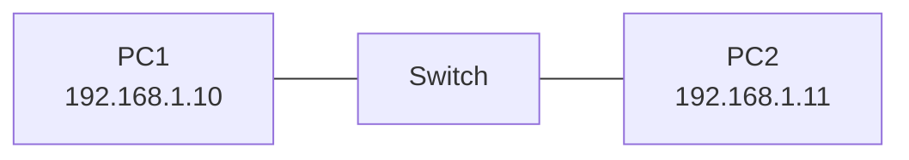

# Esercizio 1 – Due PC e uno switch

**Tempo indicativo:** 20 minuti · **Argomenti:** indirizzi IP, ping, ruolo dello switch

## Obiettivo

Far comunicare due computer nella stessa rete locale.

## Topologia

## Istruzioni

1. Apri [ReteLab](https://pg-laboratorio.github.io/retelab/) e scegli **Carica esempio → Progetto vuoto**.
2. Dall'elenco **Dispositivi** aggiungi uno switch e due PC: si chiamano già PC1 e PC2.
3. Scegli lo strumento **Cavo** e collega ciascun PC allo switch: clicca il PC, poi lo switch.
4. Clicca ogni PC e, nella scheda **Configurazione**, assegna gli indirizzi della tabella.
5. Apri il **Terminale** di PC1 ed esegui `ping 192.168.1.11`.

| Dispositivo | Indirizzo IP | Subnet mask |
| --- | --- | --- |
| PC1 | 192.168.1.10 | 255.255.255.0 |
| PC2 | 192.168.1.11 | 255.255.255.0 |

## Domande

1. Il ping ha avuto successo? Riporta l'output.
2. Allo switch hai assegnato un indirizzo IP? Perché non è necessario per inoltrare i pacchetti?
3. Cambia l'IP di PC2 in 192.168.2.11 e ripeti il ping. Cosa succede e perché?

---

[Soluzione](../soluzioni/01-due-pc-e-uno-switch.md) · [Esercizio successivo →](02-chi-sta-nella-mia-rete.md)
