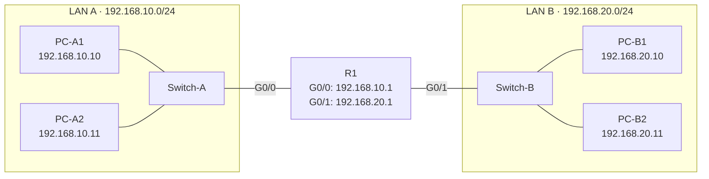

# Esercizio 3 – Due LAN e un router

**Tempo indicativo:** 45 minuti · **Argomenti:** router, gateway predefinito

## Obiettivo

Collegare due reti diverse e capire il ruolo del gateway predefinito.

## Topologia



| Dispositivo | Interfaccia | Indirizzo IP | Subnet mask | Gateway |
| --- | --- | --- | --- | --- |
| R1 | G0/0 (verso LAN A) | 192.168.10.1 | 255.255.255.0 | — |
| R1 | G0/1 (verso LAN B) | 192.168.20.1 | 255.255.255.0 | — |
| PC-A1 | — | 192.168.10.10 | 255.255.255.0 | 192.168.10.1 |
| PC-A2 | — | 192.168.10.11 | 255.255.255.0 | 192.168.10.1 |
| PC-B1 | — | 192.168.20.10 | 255.255.255.0 | 192.168.20.1 |
| PC-B2 | — | 192.168.20.11 | 255.255.255.0 | 192.168.20.1 |

## Costruzione

1. Aggiungi un router, due switch e quattro PC. Rinominali come nella tabella: il nome si cambia cliccando il dispositivo e scrivendo nel campo in alto.
2. Collega il router **prima a Switch-A e poi a Switch-B**: il cavo usa la prima porta libera, quindi Switch-A finisce su G0/0 e Switch-B su G0/1. Per cambiare porta, clicca il cavo.
3. Collega i PC ai rispettivi switch e configura IP, mask e gateway.

## Configurazione del router

Come sui router Cisco, le interfacce di un router nuovo sono **spente**. Apri il **Terminale** di R1 e scrivi:

```
enable
configure terminal
hostname R1
interface g0/0
 ip address 192.168.10.1 255.255.255.0
 no shutdown
exit
interface g0/1
 ip address 192.168.20.1 255.255.255.0
 no shutdown
end
show ip interface brief
```

Le stesse impostazioni si possono dare dal pannello **Interfacce** (indirizzo, mask e spunta «Accesa»), ma in questo esercizio usa i comandi.

## Prove da eseguire

1. Da PC-A1 pinga PC-A2 (stessa rete).
2. Da PC-A1 pinga 192.168.10.1, poi 192.168.20.1.
3. Da PC-A1 pinga PC-B1.

## Domande

1. Riporta l'output di `show ip interface brief`. Cosa indicano le colonne Status e Protocol?
2. Togli il gateway da PC-A1 e ripeti la prova 3. Cosa succede e perché la prova 1 funziona ancora?
3. Perché il router ha bisogno di un indirizzo IP per ogni interfaccia, mentre lo switch no?

Esporta la rete con il nome `Cognome_Es3`: ti servirà negli esercizi 4 e 9.

---

[← Esercizio precedente](02-chi-sta-nella-mia-rete.md) · [Soluzione](../soluzioni/03-due-lan-e-un-router.md) · [Esercizio successivo →](04-dhcp.md)
