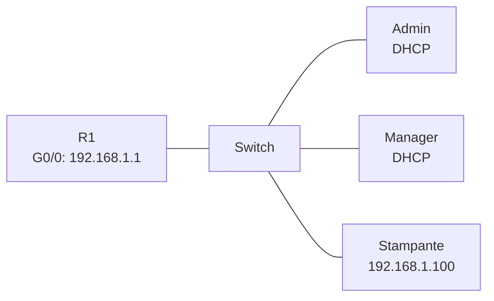

# Esercizio 6 – La LAN della nuova filiale

**Tempo indicativo:** 45 minuti · **Argomenti:** DHCP, indirizzi statici · **Ispirato a:** Cisco 14.3.4 *Create a LAN*

## Obiettivo

Allestire la rete di un piccolo ufficio, con PC che ricevono l'indirizzo dal DHCP e una stampante con indirizzo fisso.

## Scenario

Si apre una nuova filiale. Ci sono due PC (Admin e Manager) e una stampante di rete. Il router dell'ufficio deve assegnare gli indirizzi ai PC, mentre la stampante deve avere sempre lo stesso indirizzo, perché i PC la cercano proprio con quello.

| Dispositivo | Indirizzo IP | Subnet mask | Gateway |
| --- | --- | --- | --- |
| Router R1 (G0/0) | 192.168.1.1 | 255.255.255.0 | — |
| Admin | DHCP | DHCP | DHCP |
| Manager | DHCP | DHCP | DHCP |
| Stampante | 192.168.1.100 | 255.255.255.0 | da decidere (domanda 2) |

## Istruzioni

1. Aggiungi un router, uno switch, due PC e una **Stampante** (è nell'elenco Dispositivi). Rinomina i PC in Admin e Manager.
2. Collega lo switch al router, poi i due PC e la stampante allo switch.
3. Dal **Terminale** di R1 configura l'interfaccia G0/0 con l'indirizzo della tabella e accendila (`no shutdown`).
4. Configura sul router un pool DHCP per la rete 192.168.1.0/24, con gateway 192.168.1.1. Escludi dal pool gli indirizzi da 192.168.1.1 a 192.168.1.9 e anche l'indirizzo della stampante. Un singolo indirizzo si esclude così: `ip dhcp excluded-address 192.168.1.100`.
5. Imposta i due PC in DHCP e la stampante con indirizzo statico.
6. Da entrambi i PC pinga la stampante e il router.

## Domande

1. Che indirizzi hanno ricevuto i PC? Perché hanno indirizzi diversi ma la stessa mask e lo stesso gateway?
2. Alla stampante serve un gateway? Se dovessi configurarlo, quale indirizzo useresti e come lo ricavi dagli altri dispositivi?
3. Perché abbiamo escluso 192.168.1.100 dal pool? Cosa potrebbe succedere, prima o poi, se non lo avessimo fatto?
4. Perché stampanti e server si configurano di solito con indirizzo statico?

## Prova facoltativa (domanda 3)

Per vedere il problema senza collegare novanta PC, restringi il pool: togli le due esclusioni (`no ip dhcp excluded-address 192.168.1.100` e `no ip dhcp excluded-address 192.168.1.1 192.168.1.9`) e al loro posto escludi da .1 a .99. Poi su Admin scrivi `ipconfig /renew` e guarda l'indirizzo che riceve. Controlla anche `ipconfig` sulla stampante e `arp -a` su Manager dopo qualche ping verso 192.168.1.100.

---

[← Esercizio precedente](05-trova-i-guasti.md) · [Soluzione](../soluzioni/06-lan-nuova-filiale.md) · [Esercizio successivo →](07-router-di-casa.md)
