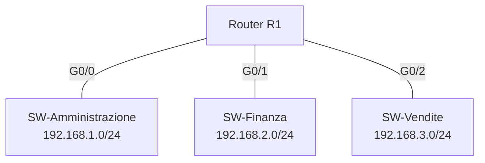

# Esercizio 8 – Dividere la rete per reparti

**Tempo indicativo:** 60 minuti · **Argomenti:** sottoreti, domini di broadcast · **Ispirato a:** Cisco 14.3.3 *Observe Traffic Flow in a Routed Network*

## Obiettivo

Confrontare una rete unica con una rete divisa in sottoreti, e capire perché le aziende separano i reparti.

## Scenario

L'azienda XYZ ha tre reparti, Amministrazione, Finanza e Vendite, ognuno con il proprio switch e due PC. Oggi è tutto in un'unica rete. Ti chiedono di proporre una rete divisa per reparti e di dimostrare cosa cambia.

## Come osservare l'ARP in ReteLab

Quando un PC deve scoprire un indirizzo MAC, la richiesta ARP **lampeggia sullo schema** su ogni dispositivo che la riceve. Dopo il ping, il pulsante **Pacchetti** riporta la stessa informazione per scritto («La ricevono: …»). Un PC chiede l'ARP solo se il MAC non è già nella sua tabella: prima di ogni osservazione svuotala con `arp -d`.

## Parte A – Rete unica

1. Collega i tre switch in catena (Amministrazione – Finanza – Vendite) e due PC a ciascuno. Per risparmiare tempo puoi importare [`08-parte-a.json`](../reti/08-parte-a.json), che contiene già switch, PC e cavi.
2. Assegna ai sei PC indirizzi da 192.168.1.11 a 192.168.1.16, mask 255.255.255.0.
3. Verifica che ogni PC pinghi tutti gli altri.
4. Da un PC di Vendite, dopo `arp -d`, pinga l'altro PC di Vendite e osserva fin dove arriva la richiesta ARP.

## Parte B – Rete divisa per reparti

1. Elimina i cavi tra gli switch (strumento **Elimina**, poi clicca il cavo) e aggiungi un router R1.
2. Collega gli switch al router nell'ordine Amministrazione, Finanza, Vendite: finiscono su G0/0, G0/1 e G0/2.
3. Configura le tre interfacce del router (ricordati di accenderle) e i PC secondo la tabella.
4. Verifica che i PC dello stesso reparto si pinghino, e poi che un PC di Vendite raggiunga un PC di Amministrazione.
5. Ripeti l'osservazione dell'ARP della parte A.

| Reparto | Rete | Interfaccia R1 | PC |
| --- | --- | --- | --- |
| Amministrazione | 192.168.1.0/24 | G0/0 · 192.168.1.1 | 192.168.1.11 e .12 |
| Finanza | 192.168.2.0/24 | G0/1 · 192.168.2.1 | 192.168.2.11 e .12 |
| Vendite | 192.168.3.0/24 | G0/2 · 192.168.3.1 | 192.168.3.11 e .12 |

Il gateway di ogni PC è l'indirizzo dell'interfaccia del router nel suo reparto.

## Domande

1. La richiesta ARP è un broadcast. Nella parte A quali dispositivi la ricevono? E nella parte B?
2. Quanti domini di broadcast ci sono nella parte A? E nella parte B?
3. Immagina che l'azienda abbia 150 PC invece di sei. Perché la rete unica diventerebbe lenta?
4. Oltre alle prestazioni, quale altro vantaggio offre separare i reparti? Pensa a chi deve poter vedere i dati della Finanza.

---

[← Esercizio precedente](07-router-di-casa.md) · [Soluzione](../soluzioni/08-rete-per-reparti.md) · [Esercizio successivo →](09-seguire-un-pacchetto.md)
