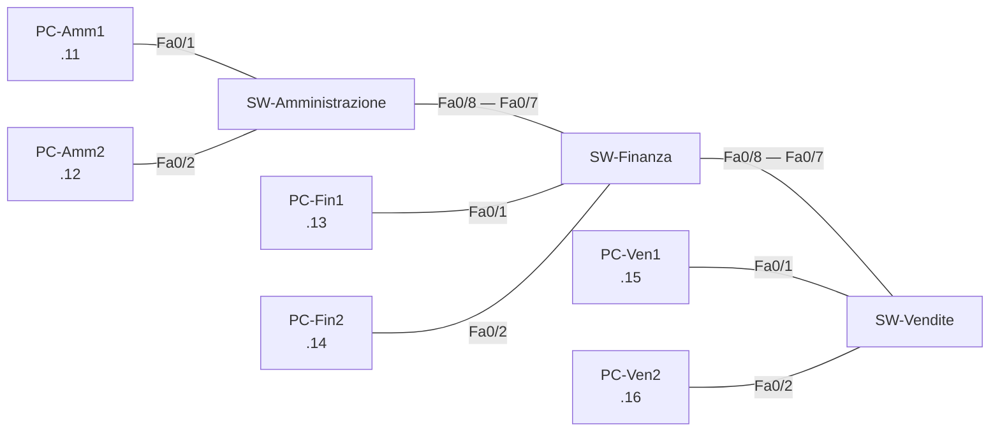

# Esercizio 11 – Come impara uno switch: la tabella MAC

**Tempo indicativo:** 45 minuti · **Argomenti:** tabella MAC, apprendimento, flooding

## Obiettivo

Capire come uno switch scopre da solo su quale porta si trova ogni dispositivo, e cosa fa quando non lo sa ancora.

## Rete di partenza

Importa [`11-tre-switch.json`](../reti/11-tre-switch.json) (sulla pagina del file, pulsante **Download raw file**; poi in ReteLab **Importa → Apri un file .json**). È la rete unica della parte A dell'[esercizio 8](08-rete-per-reparti.md), già configurata: tre switch in catena e sei PC nella rete 192.168.1.0/24.



## Come si legge la tabella MAC

Clicca uno switch e apri la scheda **Tabella MAC**, oppure il **Terminale** dello switch e scrivi:

```
show mac address-table
```

Ogni riga dice: «il dispositivo con questo MAC si raggiunge da questa porta». Lo switch scrive una riga ogni volta che riceve un frame: annota il **MAC sorgente** e la porta da cui il frame è entrato.

## Fase 1 – Le tabelle all'inizio

Controlla la tabella MAC dei tre switch subito dopo l'importazione. Cosa contiene?

## Fase 2 – Prevedi, su carta

Da PC-Amm1 farai `ping 192.168.1.16` (PC-Ven2). Ricorda che il ping è preceduto dall'ARP: PC-Amm1 chiede in broadcast «chi ha 192.168.1.16?» e PC-Ven2 risponde solo a lui.

Prima di eseguirlo, compila la tabella: per ogni switch, quali MAC avrà imparato alla fine e su quale porta?

| Switch | Dispositivo (MAC) | Porta |
| --- | --- | --- |
| SW-Amministrazione |  |  |
| SW-Amministrazione |  |  |
| SW-Finanza |  |  |
| SW-Finanza |  |  |
| SW-Vendite |  |  |
| SW-Vendite |  |  |

## Fase 3 – Verifica

1. Esegui il ping da PC-Amm1 a PC-Ven2.
2. Controlla la tabella MAC dei tre switch e confrontala con la tua previsione. La colonna **Dispositivo** della scheda Tabella MAC dice a chi appartiene ogni MAC; dal terminale, confronta i MAC con `ipconfig /all` sui PC.
3. Apri **Pacchetti**: l'ultima colonna mostra, per ogni switch, la porta d'ingresso e quella d'uscita di ogni frame.

## Fase 4 – Quando lo switch non sa: il flooding

1. Sul terminale di SW-Finanza svuota la tabella:

   ```
   enable
   clear mac address-table dynamic
   ```

2. Ripeti il ping da PC-Amm1 a PC-Ven2 e guarda lo schema mentre parte il primo pacchetto. I PC conservano la loro tabella ARP, quindi questa volta non c'è nessuna richiesta ARP.
3. Apri **Pacchetti** e leggi la colonna degli switch nella richiesta e nella risposta.
4. Controlla di nuovo la tabella di SW-Finanza.

## Domande

1. Perché, dopo il primo ping, ogni switch conosce solo due dispositivi e non tutti e sei?
2. SW-Finanza conosce PC-Amm1 sulla porta Fa0/7, a cui non è collegato nessun PC. Perché?
3. Nella fase 4, quale switch ha mandato il frame su tutte le porte? Quali dispositivi l'hanno ricevuto, e cosa ne hanno fatto PC-Fin1 e PC-Fin2?
4. Dopo il flooding, perché la risposta di PC-Ven2 non è andata in flooding anche lei?
5. Lo switch funziona senza che nessuno l'abbia configurato. Quale meccanismo glielo permette?

---

[← Esercizio precedente](10-caccia-all-errore.md) · [Soluzione](../soluzioni/11-tabella-mac.md) · [Torna all'indice](../README.md)
